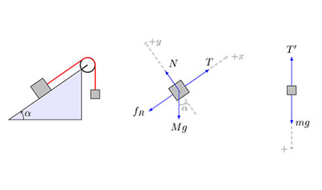

# Is AP Physics C: Mechanics Hard? Difficulty and Worth It Guide

## Quick answer

AP Physics C: Mechanics is hard because it combines calculus with fast physics modeling. You need to set up forces, motion, energy, momentum, rotation, and oscillation problems, then explain the physics with equations, graphs, diagrams, and written reasoning.

The latest complete official score data is from 2025. AP Physics C: Mechanics had a 73.2% national pass rate, 21.7% of test takers earned a 5, and 65,980 students took the exam. That pass rate is high, but the course is self-selecting: many students who take Mechanics are already strong in math and physics or are taking calculus at the same time.

## AP Physics C: Mechanics difficulty by the numbers

| Signal | What it shows |
|---|---|
| 2025 national pass rate | 73.2% scored 3 or higher |
| 2025 national 5 rate | 21.7% earned a 5 |
| 2025 test takers | 65,980 students took AP Physics C: Mechanics |
| 2025 mean score | 3.30 |
| 2026 exam date | Wednesday, May 13, 2026, at 12 PM local time |
| Exam delivery | Hybrid digital exam: MCQ and FRQ prompts in Bluebook, handwritten FRQ answers in paper booklets |
| Multiple choice | 42 questions, 85 minutes, 50% of exam score |
| Free response | 4 questions, 95 minutes, 50% of exam score |
| Fiveable FRQ practice | 835 current-year AP Physics C: Mechanics FRQ responses started across 167 profiles |

Data note: the national pass-rate, 5-rate, test-volume, and mean-score numbers describe the 2025 AP Physics C: Mechanics exam. The Fiveable FRQ number shows practice activity, not scored performance, because the queried response records did not include numeric scores. College Board's 2026 rolling score-distribution page listed AP Physics C: Mechanics but did not show 2026 percentages when this page was refreshed.

## What makes AP Physics C: Mechanics hard?

AP Physics C: Mechanics is hard because the exam expects you to build a model before you calculate. You have to decide what forces matter, choose a coordinate system, connect motion to graphs, and know when to use Newton's laws, energy, momentum, rotation, or simple harmonic motion.

The calculus is real, but it is not the only challenge. Derivatives describe changing motion, and integrals can connect force, work, impulse, and rotational quantities. The harder part is often knowing what the calculus represents in the physical situation.

Mechanics also moves quickly. The exam can ask for a diagram, equation setup, graph interpretation, limiting case, experimental design choice, and written explanation in the same task family. Formula recall alone will not carry the course.

## Why the high pass rate needs context

A 73.2% pass rate can make AP Physics C: Mechanics look easier than AP Physics 1, but that comparison can mislead students. Physics C: Mechanics is calculus-based, and the student group is often more prepared in math and science.

The course is usually taken by students who have already chosen a STEM-heavy path. Many are taking calculus, have taken another physics class, or are preparing for engineering or physical science. That self-selection helps explain why the pass rate is high even though the content is demanding.

The 21.7% 5 rate shows that prepared students can do well. It does not mean the course is light. If calculus, vectors, or algebra are shaky, Mechanics can feel hard from the first unit.

## What the exam actually asks you to do

Free Body Diagrams similar to the type you will draw on your assignments and the AP Test. Image Courtesy of CK-12

The AP Physics C: Mechanics Exam is a hybrid digital exam. You answer multiple-choice questions in Bluebook, view free-response prompts in Bluebook, and handwrite FRQ answers in a paper booklet.

| Exam part | Timing and weight | What makes it difficult |
|---|---|---|
| Section I: multiple choice | 42 questions, 85 minutes, 50% | Questions may be discrete or set-based, with stimuli, data, diagrams, equations, graphs, or physical situations. |
| Section II: free response | 4 questions, 95 minutes, 50% | The FRQs include mathematical routines, translation between representations, experimental design and analysis, and qualitative/quantitative translation. |

Calculators are permitted. Reference materials are available for the course and are provided in Bluebook and in printed form.

## Where students lose points

AP Physics C: Mechanics mistakes usually come from weak setup, not just weak arithmetic.

- **Forces and free-body diagrams:** Missing a force, adding a force that does not exist, or choosing poor axes can break the whole solution.
- **Kinematics with calculus:** Students mix up position, velocity, acceleration, derivatives, and integrals when motion is not constant.
- **Energy and work:** The sign of work, nonconservative forces, spring energy, and gravitational potential can create errors.
- **Momentum and impulse:** Collisions, center of mass, and impulse-momentum reasoning require clear system boundaries.
- **Rotation:** Torque, angular momentum, rotational inertia, rolling, and equilibrium often feel like mechanics with new variables and stricter diagrams.
- **Oscillations:** Springs, pendulums, energy, and differential relationships require both conceptual and mathematical reasoning.
- **FRQ explanations:** A correct equation is not always enough. You often need to explain why the model, graph, or relationship fits the situation.

## Who will probably find AP Physics C: Mechanics easier

AP Physics C: Mechanics will feel more manageable if you are comfortable with calculus, algebra, vectors, graph interpretation, and multi-step problem solving. A previous physics course can help, but strong math habits matter just as much.

Students who like seeing math describe real motion often enjoy the course. Mechanics gives you a way to connect equations to carts, blocks, springs, pendulums, ramps, collisions, and rotating objects.

It may feel harder if calculus is brand new or if you have not built strong algebra fluency. The exam does not wait for you to slowly untangle every equation. You need enough math comfort to spend attention on the physics.

## Is AP Physics C: Mechanics worth taking?

AP Physics C: Mechanics is worth taking if you are interested in engineering, physics, computer science, architecture, robotics, aerospace, pre-med, applied math, or other STEM paths. It is one of the clearest AP previews of college-level calculus-based physics.

It can also be useful if you want to strengthen problem-solving habits. The course rewards clean diagrams, clear assumptions, precise variables, and explanations that connect math to physical meaning.

The caution is sequencing. Mechanics is a better fit if you are taking calculus or already have calculus skills. Without that foundation, the course can become much harder than the pass rate suggests.

## A two-week AP Physics C: Mechanics study path

If you have two weeks before a major checkpoint, organize review by physical model. Start with force and motion before moving into energy, momentum, rotation, and FRQ communication.

| Days | What to do | Why it helps |
|---|---|---|
| Days 1-2 | Review kinematics and Newton's laws. For each problem, draw a diagram, choose axes, define variables, and connect position, velocity, and acceleration. | Mechanics starts with modeling motion and forces clearly. |
| Days 3-4 | Practice free-body diagrams and force equations for ramps, pulleys, circular motion, friction, and springs. | Force setup controls the rest of the calculation. |
| Days 5-6 | Work on work, energy, and power. Identify the system, choose initial and final states, and decide whether nonconservative work matters. | Energy questions reward good system boundaries. |
| Days 7-8 | Practice momentum, impulse, collisions, and center of mass. State what is conserved and why before calculating. | Momentum problems depend on choosing the right system. |
| Days 9-10 | Review rotation and equilibrium. Draw torques, connect linear and angular variables, and check units for rotational inertia and angular momentum. | Rotation is often where familiar mechanics ideas feel new again. |
| Days 11-12 | Practice oscillations and mixed calculus setups. Write what the derivative or integral means physically before solving. | Calculus points are easier when the physics meaning is clear. |
| Days 13-14 | Do one FRQ of each type: mathematical routines, translation between representations, experimental design, and qualitative/quantitative translation. Review errors by category. | The FRQ section tests communication and setup as much as calculation. |

For ongoing review, keep a model sheet. For each topic, write the diagram type, core equations, assumptions, common graph shape, and one sentence explaining what the math means.

## Bottom line

AP Physics C: Mechanics is hard even though the pass rate is high. The students who take it are usually prepared, and the exam expects calculus-based modeling with clear diagrams, equations, graphs, and explanations.

If you like math-heavy physics and have a solid calculus foundation, Mechanics can be a strong AP choice. If calculus or algebra still feels shaky, build that foundation early before the course starts stacking models on top of each other.

## Frequently Asked Questions

### Is AP Physics C: Mechanics hard?

AP Physics C: Mechanics is hard because it combines calculus with forces, motion, energy, momentum, rotation, oscillations, graphs, diagrams, and written physics reasoning. The pass rate is high, but the course is self-selecting and usually taken by students with strong math preparation.

### What is the AP Physics C: Mechanics pass rate?

The 2025 AP Physics C: Mechanics pass rate was 73.2%, with 21.7% of students earning a 5 and a mean score of 3.30. College Board had not posted 2026 Mechanics percentages when this page was refreshed.

### What makes AP Physics C: Mechanics difficult?

The hardest parts are calculus setup, free-body diagrams, force modeling, energy and momentum system choices, rotation, oscillations, graph interpretation, and explaining the physical meaning of equations on FRQs.

### Is AP Physics C: Mechanics worth taking?

AP Physics C: Mechanics is worth taking if you are interested in engineering, physics, computer science, robotics, aerospace, pre-med, applied math, or other STEM paths and have a strong calculus foundation.

---

Source: [https://fiveable.me/ap-physics-c-mechanics/ap-physics-c-mechanics-exam/ap-physics-c-mechanics-is-it-hard/study-guide/SGcFKDRd3HhoWAvitHqt](https://fiveable.me/ap-physics-c-mechanics/ap-physics-c-mechanics-exam/ap-physics-c-mechanics-is-it-hard/study-guide/SGcFKDRd3HhoWAvitHqt)
